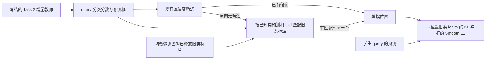

# 开放世界目标检测：从未知物体发现到有实例依据的新类适配

2026-11-18 修订研究方案。M 分支已实现 discovery v10，并提供双 RTX 3090 的两任务短程对照。效果待服务器评估。旧方案见[原有三模块实现](owod-discovery-transition-design.md)。

## 研究问题与证据

在当前任务只有部分类别标注时，检测器能否先定位未命名物体，学到可复用的实例表示，等新类标注释放后，用历史实例帮助学习该类，同时保持旧类检测能力？研究的核心假设是：若多个带标注的新类实例能够独立检索到一致的历史匿名实例，那么这些实例的特征可以为新类 adapter 提供额外监督。是否有益要由跨任务对照回答。

| 现有观测 | 设计依据 |
| --- | --- |
| S，v5 Task 1 末轮冻结权重，在固定 512 张训练图上用后来释放的标注做事后核对。629 个 Task 2 物体中，任一原始 query 框在 IoU≥0.5 时覆盖 127 个，筛选出的 pseudo 覆盖 5 个，匹配到既有成熟匿名槽的 pseudo 覆盖 0 个。 | 同时跟踪原始候选覆盖与筛选保留。该切片描述末轮状态，整段训练历史和其他未来类别另行解读。 |
| S，从同一父权重建立 Task 2 新类分支，21 类均未继承非零映射。389 个 GT 匹配实例中，83 个匹配框达到 IoU≥0.5；这些实例在原始和投影特征空间均无一个通过旧 0.8 门槛。 | 单纯改为逐实例查找仍可能得到空匹配。需要同时改善候选与特征，并允许新类放弃迁移。此次没有形成有效的继承训练对照。 |
| M，v8 focal Task 1 第 50 轮，Known AP50 58.50%，U-Recall 12.56%，unknown precision 1.56%，输出 188,261 个 unknown。 | 提升覆盖时同时关注误检和已知检测。该运行回答 Task 1 检测问题，跨任务迁移需要 M 自身的后续对照。 |

## 模块一　类别无关定位与未知发现

**输入**为当前图像的多尺度 encoder 特征、有效区域掩码和当前已释放的训练框。**输出**为经过 decoder 精修的框、对应的 query、匿名候选掩码及置信权重。推理仍通过现有已知类与 unknown 评分和固定输出预算产生检测结果。

1. 在 Deformable DETR 的 encoder 与 decoder 之间加入类别无关定位头。对多尺度网格预测框偏移和定位质量。用已释放 GT 的中心附近位置训练框回归，以候选框对所分配 GT 的实际 IoU 作为质量目标并停止该目标的梯度。对已标注物体周围的好框与偏框都提供质量监督；未标注区域的语义身份保持未知。
2. 在固定的 Q 个 decoder queries 内，用一部分位置承接质量较高、空间去重后的 encoder 候选，其余位置继续用 learned queries。首版沿用一阶段 decoder 的二维参考点接口，用候选框中心作为参考点，把框的位置、尺度编码和对应 encoder 特征送入该位置的 query。两组 query 一起进行现有检测匹配，训练和推理走同一入口。
3. 在 decoder 输出上先排除已释放 GT 匹配及明显重叠框，再核对学生和 EMA 教师在两个视图中的位置和特征。将定位质量纳入匿名候选排序，保留现有已知类证据、原型 affinity、去重和每图 pseudo 上限。learned queries 和候选初始化的 queries 均可入选；两者的定位质量需在同一尺度上计算，例如用同一质量头在各自框中心的 encoder 特征上评估最终框。阶段一输出的 pseudo 监督共享 discovery adapter。

定位质量用于判断框的几何可信度，novelty 用于估计已选物体属于未知的可能性。类别无关定位可参考 OLN，学习未知实例表示可参考 OW-Rep。两者提供已有技术依据，本方案的研究假设集中于历史实例证据对后续监督学习的贡献。[OLN 原论文](https://arxiv.org/abs/2108.06753) · [OW-Rep 原论文](https://openaccess.thecvf.com/content/WACV2026/papers/Lee_OW-Rep_Open_World_Object_Detection_with_Instance_Representation_Learning_WACV_2026_paper.pdf)

## 模块二　匿名实例表示学习与有条件的新类迁移

**Task 1 如何学习。** 共享 discovery adapter 继续参与 decoder 前向，接受物体性、novelty、路由与跨视图监督。从受 adapter 影响的最终 query 产生归一化实例特征。对可信 pseudo，将双视图中同一物体的特征拉近；用已释放 GT 的类别关系约束同一个投影空间，使不同物体不至于全部收敛到同一点。跨视图正例只表示同一实例，两张图的匿名候选不会仅凭同槽就获得相同类别标签。

**任务之间传什么。** 原型中心供粗检索，每个匿名槽再保留少量来自不同图像的实例代表。每条代表包含归一化特征、来源图像 ID、定位质量和候选权重。同一来源去重，槽内兼顾代表性与质量；槽数、每槽上限、向量维度和实际字节数写入运行计划。首版在任务结束时，用冻结的阶段末模型对该阶段合法训练清单做一次固定预算的只读提取，在统一特征空间中形成供下一任务读取的代表库。训练中的在线原型仍服务当前图像前向。跨任务检索使用该代表库的中心和实例向量，记录父权重哈希。提取的图像数、额外前向时间及存储在各迁移对照中等额计入；作者均衡记忆沿用原清单。

**Task 2 如何使用。** 新类标注释放后，用同一冻结父模型编码本任务有标注的新类实例。按 GT 匹配框的定位质量筛选查询，先查询原型，再检查实例代表。在决策时排除相同来源图像，要求同一新类有来自不同图像的支持，并检查相对其他槽或竞争类别的相似度余量。记录接受和拒绝的依据。门槛和预算在运行前固定，可用已释放类别模拟关联来校准。允许每个类返回空集合。

对通过匹配的新类实例，用检索到的代表形成冻结的加权特征目标。在当前模型的 GT 匹配 query 上增加余弦对齐损失，让梯度到达被路由的新类 adapter。检索关系与教师目标停止梯度；目标和学生使用相同的父投影坐标，学生侧冻结投影参数而保留对输入的梯度。原有 router 的 GT 中心初始化保留。证据不足时只用本任务的常规监督；进入新任务时新类 adapter 取相同的默认初始化，相似槽的历史共享 adapter 快照留作原实现对照。训练后模型可独立推理，实例匹配和对齐仅在训练时使用。

## 模块三　联合学习与旧类保持

保留 query 路由、干扰风险门控、冻结旧类分支、旧教师蒸馏及作者均衡微调。定位头和实例表示在 Task 1 学习；首版在后续适配阶段冻结新增定位头，沿用目标对照的检测器冻结策略，避免把定位容量变化混入继承收益。新任务的共享 discovery adapter 继续在当前图像上学习尚未命名的物体。

在原联合损失上加入三项：定位监督（框与质量）、实例表示监督、只对匹配证据充分的新类启用的历史特征对齐。复用原跨视图一致性，对同一特征对只计一次。历史特征对齐按接受的匹配数和置信权重归一化，空集合贡献为零。记录命中分支及实际梯度，以区分“检索到历史实例”和“历史实例参与新类更新”。发现图的 affinity 描述实例关联，干扰 GNN 的输出描述新类更新对旧类的风险。

## 实现顺序与实验判据

| 步骤 | 本地代码改动 | 判断依据 |
| --- | --- | --- |
| 1. 先贯通候选生成 | 在 [transformer](../models/deformable_transformer.py) 的 encoder 输出和 decoder 初始化之间接入定位头。复用多尺度网格、padding mask、有效区域坐标和现有框工具。在 [detector](../models/deformable_detr.py) 透传训练所需输出，在 [discovery criterion](../models/graph_local/discovery.py) 计算定位监督，在 [候选挖掘](../models/graph_local/discovery_candidates.py) 中接入质量排序。 | 同一固定切片、IoU、query 数及 pseudo 数上限，分别统计 encoder 候选、全部 decoder 框和最终 pseudo 覆盖的 GT 数，同时报告实际候选数。若原始覆盖改善而 pseudo 仍大量丢失，先定位哪项筛选造成损失。未来类 GT 只用于事后计分。 |
| 2. 贯通实例学习与保存 | 在 [发现分支](../models/graph_local/discovery.py) 接入实例特征和相应损失；在 [原型内存](../models/graph_local/discovery_memory.py) 定义带来源的定额代表库。复用 [阶段训练与 checkpoint 入口](../main.py) 调度阶段末冻结提取，并在跨任务加载前核验父权重、manifest 和特征配置。 | 报告覆盖多少独立图像、槽中有多少有效代表、检索是否集中到少数槽。Task 2 标注释放后按类查看定位合格实例的检索结果。只有命中数上升而匹配失去区分度时，仍需改检索表示。 |
| 3. 接入新类训练 | 扩展 [跨任务特征收集](../tools/owod/graph_adaptation.py)，在按类求均值前保留实例、图像 ID 与框 IoU；将训练实例或标注 ID 与冻结检索目标关联。在 [跨阶段初始化](../main.py) 接入目标映射，在 discovery criterion 中根据当前 batch 的 GT 匹配索引取目标并计算对齐损失。在线实例中心与阶段末历史库分别保存。 | 从同一个新 Task 1 父权重比较真实匹配、打乱对应关系、关闭迁移。打乱组保持接受实例、权重和类别覆盖，重排历史目标；单一目标等无法构造有效打乱的情形要记录。零匹配时终止迁移收益比较。 |
| 4. 接入正式链与报告 | 在 [运行计划](../tools/owod/run_benchmark.py)、[配置与续训校验](../tools/owod/strict_setting.py) 和训练参数中注册独立方法配置。将候选配额、两类记忆预算、投影版本、匹配规则及对齐系数写入计划。M 和 S 分别迁入各自已核对的代码与训练配置。 | 固定起点、参数容量、评分、训练预算和评估轮次；候选模块单列与旧方案的参数及计算差。各协议分别报告 Previous / Current / Known AP50、有未知时的 U-Recall、precision、预测数、WI、A-OSE。短程 increment 与完整 increment → balanced finetune 分开解释。 |

新版改变 Task 1 的候选、实例表示和 checkpoint 内容，正式实验从各协议相同的基础预训练起点另建任务链。已有权重、日志和作者均衡记忆可继续用于原方案对照。本文未给新增配额、阈值或损失权重指定实测最优值，也没有生成新版 AP。

## M-OWODB 双 RTX 3090 迁移对照

本实验比较同一个 discovery v10 父模型在三种历史实例监督下的 Task 2 表现。使用 M 作者清单、DINO ResNet-50、seed 42、每卡 batch 2、focal 评分、soft 类别路由和旧类蒸馏。训练子集属于诊断配置。七个阶段末均使用完整 M 作者测试清单和 VOC 积分 AP50 评估。

| 阶段 | 图像与预算 | 运行次数 |
| --- | --- | --- |
| Task 1 increment | 作者增量训练清单中固定选 6,144 张，训练 8 轮 | 一次，使用第 8 轮末权重 |
| 历史实例库与 GNN | 用父模型及其 EMA 在上述训练图中固定扫描 4,096 张。最多 32 槽，每槽保留 8 个不同图像的实例代表 | 一次，三组共用 |
| Task 2 increment | 固定 1,536 张增量训练图，训练 3 轮 | matched、off、shuffled 各一次 |
| Task 2 balanced finetune | 完整作者均衡记忆清单 1,743 张，训练 1 轮 | 每组接自己的增量末轮权重 |

matched 使用检索到的历史实例，off 关闭对齐损失，shuffled 在相同的已接受实例之间置换对齐目标并保留权重。三组均运行，程序核验父权重、GNN 与检索缓存 SHA256。匹配门槛沿用原方案，若有效匹配为零或未交换不同槽的目标，报告会将迁移收益标作证据不足。

服务器仓库根目录执行下列命令。启动器使用现有 tree-detr 环境，默认 GPU 0、1。相同提交、输入和配置下重跑启动命令可续接中断阶段。

```bash
tmux new -d -s m-transfer 'bash tools/owod/run_instance_pilot.sh'
tail -f output/m-instance-expanded/console.log
```

每阶段的 train.log、metrics.jsonl 和 checkpoint.pth 位于对应组别目录。comparison.json 记录实例库实际扫描图数、保留的代表和不同来源图数、接受的类别，以及各组在 increment、balanced finetune 固定末轮的指标和差值。candidate_coverage.json 单独统计 Task 1 的候选覆盖。先看 matched 的末轮 Current AP50 是否同时高于 off 和 shuffled，再看 Previous/Known AP50、U-Recall、precision、预测数、WI 和 A-OSE 的变化。一次短程单种子结果用于决定是否扩大训练。

按全局 batch 4 计，Task 1 约 12,288 步，三个 Task 2 合计约 4,764 步，另含七次完整评估、一次 GNN 校准及历史库提取。双 3090 空闲时先预留 5–9 小时。历史 M 全量 Task 1 的训练与评估耗时见[双卡记录](owod-control-lr-quarter-epoch8-analysis-20261111.md)；v10 的实际吞吐和磁盘读取速度要以本次日志为准。

## Task 2 均衡微调的旧类蒸馏对照

六轮增量后的教师在均衡训练图上很少给出超过 0.3 的旧类分数。seed 42 和 43 分别有 2,993 和 3,360 个旧类目标拥有定位正确、旧类中分类正确的候选，但其所有正确候选都低于门槛。每张空选图直接补入一个高分候选时，均衡图上的正确匹配率分别为 51.49% 和 56.49%。本诊断检验均衡图中已释放的标注能否帮助选择蒸馏位置，改善训练后的旧类 AP50。



实验开关 `--screen-annotated-distill` 只用于 Task 2 均衡微调。若一张训练图没有通过原门槛的候选，先找出在全部已知类中预测类别与已标注旧目标一致、且框 IoU > 0.5 的 query，再取旧类置信度最高的一个。没有匹配则不增加蒸馏位置。日志列 `distill_annotated_queries_unscaled` 记录每卡每批新增的 query 数。[选择与损失](../models/graph_local/distillation.py)

两枚 seed 各自从同一增量末轮权重开始，在同一提交下运行原规则与补充规则，共四次单轮微调。以 1,024 张独立留出图上均衡微调末轮的 Previous AP50 为主端点，同时比较 Current 和 Known AP50。两枚 seed 均须达到 Previous 至少增加 0.5 个百分点、Current 至多下降 0.5 个百分点且 Known 上升，才进入下一轮验证。[配对启动器](../tools/owod/run_task2_annotated_distillation.py)

补充规则在 seed 42/43 上分别降低 Previous AP50 0.182/0.192 个百分点，Known 也下降。后续对照保留原规则。

## 六轮增量训练下的历史实例对齐

两份使用 12,288 张图训练 12 轮的 Task 1 父模型，从各自历史库中分别匹配到 79 条、234 条实例记录，覆盖 12 个、13 个新类。每个 seed 的三条链共用其父模型、校准 GNN、实例库、训练图及优化配置。Task 2 各训练六轮增量、一轮均衡微调。真实匹配组按既有检索目标对齐；打乱组保留相同的当前实例和权重，重排历史槽位的目标特征；关闭组保留实例库与其余训练损失，仅关闭历史实例对齐。运行记录同时检查增量期实际对齐数和跨槽打乱数。

主端点是 1,024 张独立留出图上的微调末轮 Current AP50，另记有匹配和无匹配类别的分组 AP50。在两个 seed 上，真实匹配相对两个对照均须增加至少 0.5 个百分点的 Current AP50，相对关闭组的 Previous 至多损失 0.5 个百分点且 Known 上升，才扩大验证。作者测试清单的阶段指标留作报告。[运行计划及端点](../tools/owod/run_task2_history_alignment.py)

真实匹配相对关闭组的 Current AP50 在 seed 42 和 43 分别变化 +0.046 和 −0.186 个百分点，相对打乱组分别变化 +0.184 和 +0.090。仅统计有匹配的新类时，相对关闭组分别变化 −0.082 和 −0.053 个百分点。79 / 234 条历史特征在打乱对照中都发生了跨槽重排，两组均有实际对齐梯度所需的匹配实例。

下一项诊断固定两个 Task 1 检测器、历史槽的代表特征、既有检索门槛，以及在 Task 2 增量训练图上确定的槽位类别。在同一 1,024 张留出图上，只对 Task 2 已释放的新类标注做一对一 IoU 分配，逐级统计定位、检索、命中已命名槽、类别正确的实例数。留出标注仅用于确定诊断位置与计数，不更新权重或槽位。两个 seed 的已命名匹配均至少三分之二正确，且正确命中至少覆盖全部新类 GT 的 5% 时，转查对齐损失。正确率不足时先查槽位的类别归属，正确率足够而覆盖不足时检查各步流失。[冻结检索诊断](../tools/owod/probe_task2_history_retrieval.py)
